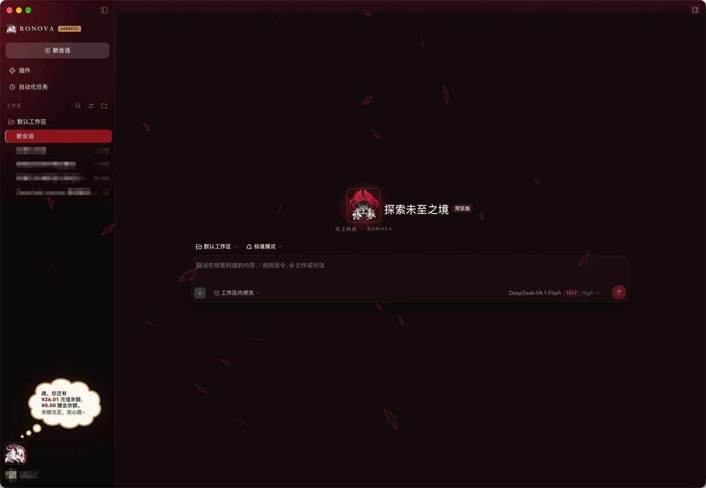
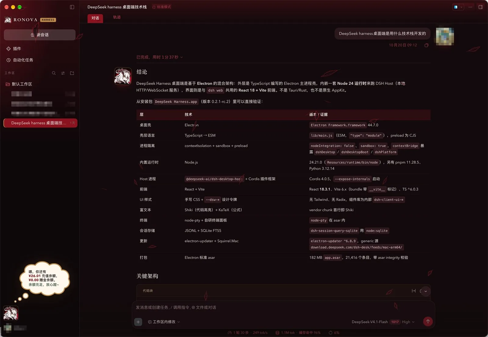
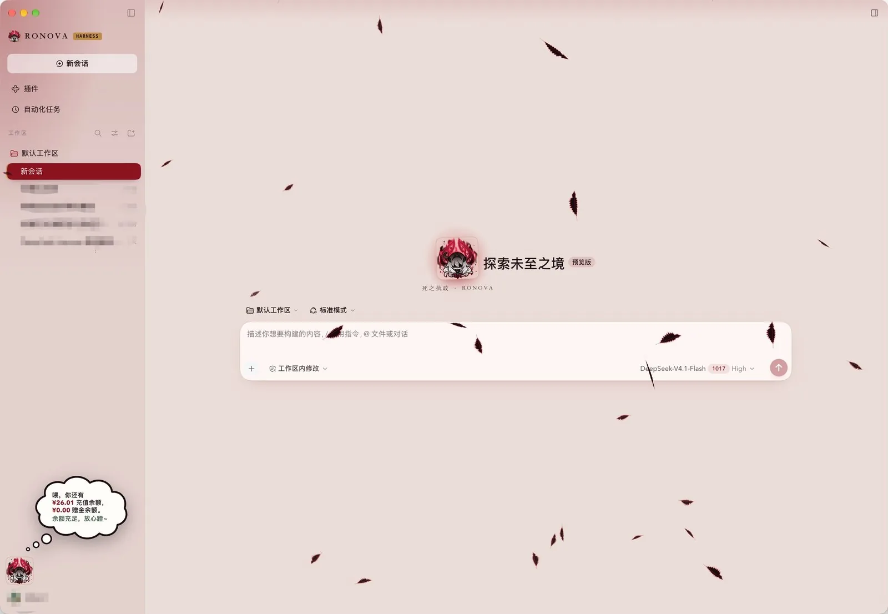
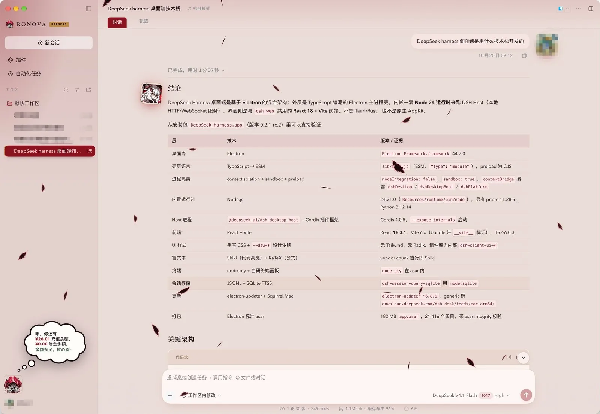

# 若娜瓦主题 · RONOVA

为 DeepSeek Harness Web UI 做的整套视觉换肤：绯红、灰烬与金瞳的配色，宋体标题，酒红选中态，以及出现在空状态、侧栏、对话两侧的若娜瓦 Q 版贴纸。

这是一个纯客户端插件 Bundle（Host 半边为空），不改动 Harness 的任何宿主逻辑，卸载后界面立即回到原样。

---

## 预览

| 深色 · 新对话 | 深色 · 对话 |
| :---: | :---: |
|  |  |

| 浅色 · 新对话 | 浅色 · 对话 |
| :---: | :---: |
|  |  |

截图取自 2462×1702 的原始界面，仓库里存放的是 1600px 宽、WebP 质量 82 的版本（合计约 220 KB）。

---

## 效果一览

### 配色与层次
- 重新定义了深浅两套主题令牌：`#EADCD8` 灰烬纸底 / `#120A0C` 深墨底，酒红主色 `#8A1220`
- 侧栏与顶栏有一层随时间稳定的酒红晕染，深浅可调
- 选中会话行、激活标签页、发送按钮统一为实心酒红
- 用户消息气泡用暖酒红，不再是默认的中性灰

### 排版与正文
- 标题（h1–h4）使用宋体，正文使用 Avenir Next / 苹方，代码使用 SF Mono
- 代码块：暖纸底 + 金色细边 + 暖色标题栏，语言标签用暗金
- 表格：表头淡酒红、金色横线、去纵线
- 引用块金色左线 + 宋体斜体，`hr` 为两端渐隐的金线，列表标记酒红
- 行内代码是金棕描边的小标签

### 角色元素
- 空状态贴纸下方有一行宋体副题「死之执政 · RONOVA」
- 侧栏品牌位是随机贴纸 + `RONOVA / HARNESS` 字标
- 助手消息左侧、用户消息右侧在宽屏（≥1200px）下会挂 60px 贴纸
- 生成中时输入区下方有脉动的贴纸徽标
- 全窗口飘落黑色羽毛：程序生成的不对称羽枝轮廓，深色下靠酒红轮廓光被看见

### 设置页
设置里新增「若娜瓦」分区，所有调节即时生效并持久化在 `localStorage`（键 `ronova.settings.v1`）：

| 设置项 | 档位 | 说明 |
| --- | --- | --- |
| 色浓度 | 淡 / 标准 / 浓 | 侧栏与顶栏酒红晕染强度 |
| 角色贴纸 | 显示 / 隐藏 | 关闭后隐藏对话两侧贴纸、等待动画与空状态贴纸；品牌标和头像保留 |
| 明暗 | 浅色 / 深色 | 等价于点侧栏头像切换 |
| 飘落羽毛 | 关 / 少 20 / 标准 34 / 多 52 | 同屏羽毛数量 |
| 羽毛浓淡 | 淡 0.6 / 标准 1 / 浓 1.45 | 乘在每层透明度上 |
| 羽毛大小 | 小 0.75 / 标准 1 / 大 1.4 | 尺寸缩放 |
| 羽毛形态 | 混合 / 长羽 / 短羽 | 尺寸分布偏好 |

底部「恢复默认」可一键回到初始值。

## 快捷操作

- **点侧栏中部的若娜瓦头像**：切换浅色 / 深色
- 侧栏收起时头像会缩成 36px，仍然可点

## 安装

本包通过 `package.json` 里的 `dsh.bundle.patch` 声明自己是一个 Bundle，安装时由插件管理器把下面这条插进 Harness 的插件树：

```yaml
- insert:
    - id: ronova
      name: '@local/ronova'
```

推荐流程：

1. 打开 Harness 的「插件」页，安装本包（本地目录或 npm 源均可）
2. 确认插件列表里出现「若娜瓦主题」
3. 刷新页面，主题生效

手动方式（开发时常用）：

1. 把仓库目录 link 进当前 profile 的 `node_modules`（`pnpm link` 或 `pnpm add file:../ronova`）
2. 在 profile 的 Cordis 配置里加入上面的 `insert`
3. 重启 Harness 或刷新 Web UI

插件依赖三个客户端包：`dsh-client-ui-theme`、`dsh-client-ui-sidebar`、`dsh-client-ui-conversation`，它们在 `package.json` 的 `dsh.client.inject` 中声明，缺失时插件不会加载。

## 使用上的几个注意点

- **贴纸素材内嵌在 `client.js` 里**（base64 WebP），所以插件不依赖任何静态资源路由；代价是文件偏大
- 品牌位（`sidebar.brand.mark` / `sidebar.brand.name`）是 Harness 的**单槽位**，本插件用 `priority: -1` 抢占；同优先级的注册会抛错并回滚整个插件
- 主题令牌走 `theme.overrideTokens`，卸载即恢复；样式表挂在 `shell.overlay` 的 `ronova.skin` 上
- 开启「减少动态效果」（`prefers-reduced-motion`）时，羽毛不再生成，贴纸脉动也会停
- 窗口不可见时羽毛动画自动暂停

## 目录结构

```
ronova/
├── package.json        # 包信息、dsh.bundle / dsh.client 声明
├── cordis.patch.yml    # Bundle 的插入补丁
├── index.js            # Host 半边（空实现）
├── client.js           # 全部实现：CSS、令牌、组件、羽毛动画
├── icon.png            # 插件列表图标
├── locale/{zh,en}.json # 插件元信息文案
├── docs/preview/       # README 用的四张预览图
└── README.md
```

## 开发

- 没有构建步骤：`client.js` 是手写的 ESM 模块，直接以 `window.__ModuleLoader__.load` 注册
- 仓库以 link 方式装进 profile 后，**改 `client.js` 会热重载**，不用刷新页面
- 样式集中在 `client.js` 的 `CSS` 模板字符串里，按注释分段：令牌 → 侧栏细节 → 正文排版 → 卡片/浮层 → 输入区 → 空状态与设置页 → 羽毛 → 贴纸
- 令牌覆盖写在 `OVERRIDES` 对象里，只包含 Harness 暴露的 14 个别名令牌；更深层的静态色板（`--dsw-static-*`）在 CSS 里直接覆盖
- 贴纸组件全部用 `React.createElement`，没有 JSX，也没有除 `react` 之外的依赖

改动建议一次一个主题（例如「只调代码块」）提交，方便回退。

## 已知限制

- **无法修改 macOS Dock / 访达里的应用图标**：那来自 `.app` 包内的 `icon.icns`，插件层没有对应接口
- 页面 favicon 可以改，但 Harness 桌面端没有标签页，看不出效果
- 部分原生控件的类名带构建哈希（形如 `_7514NG_sectionLabel`），升级 Harness 后可能失效，需要重新对照

## 仓库

- 源码：<https://github.com/iKode423/dsh-ronova-theme>
- 提交约定：`feat:` 新功能、`style:` 纯视觉调整、`fix:` 修复、`docs:` 文档、`chore:` 杂项
